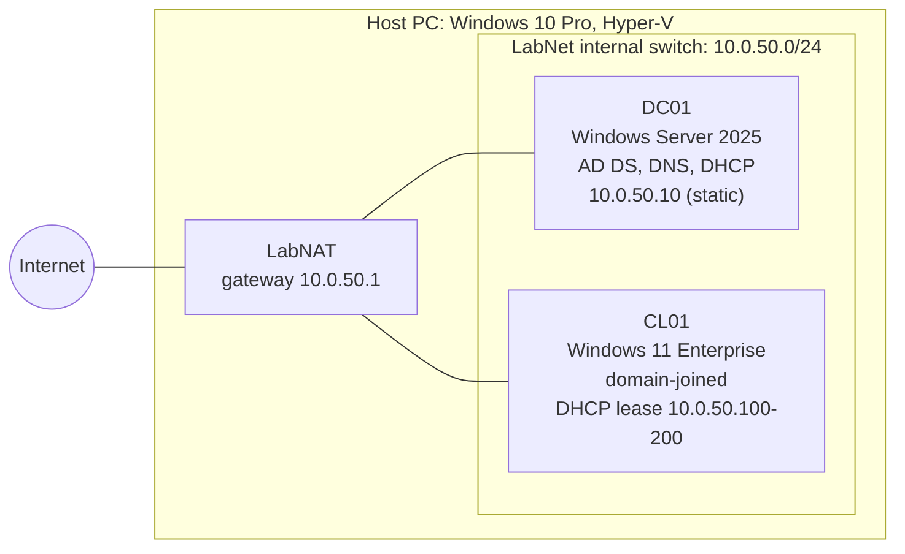
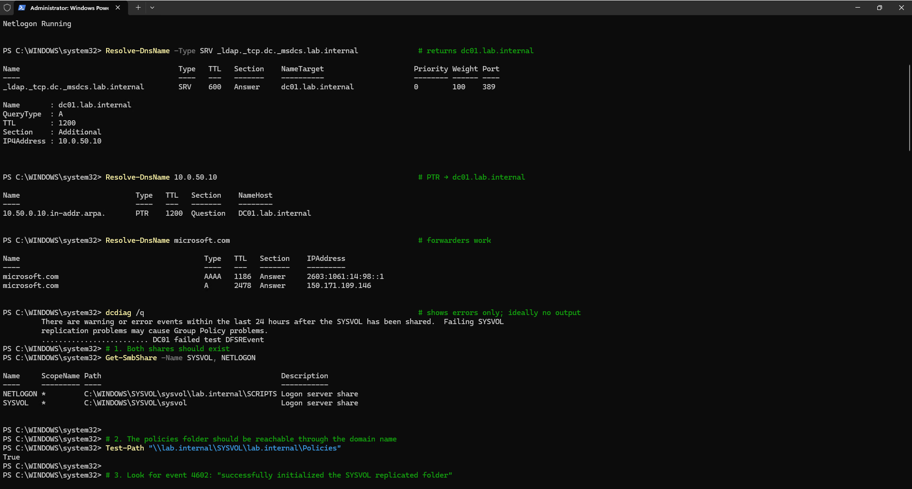
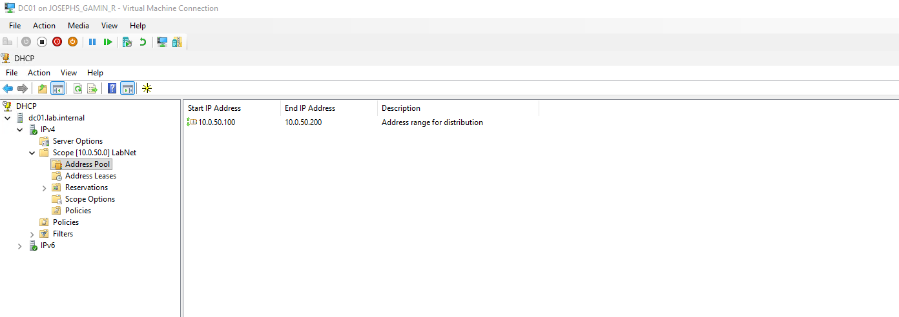
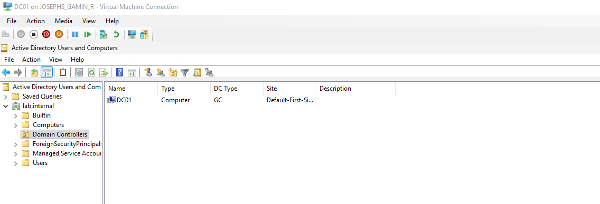
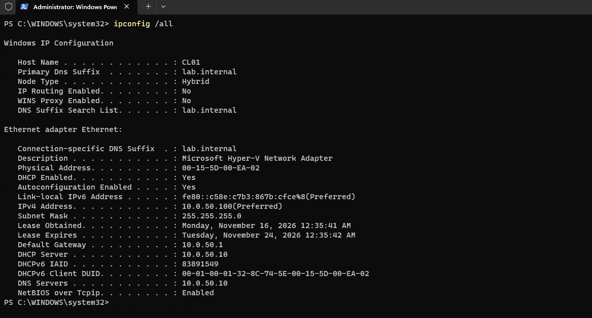
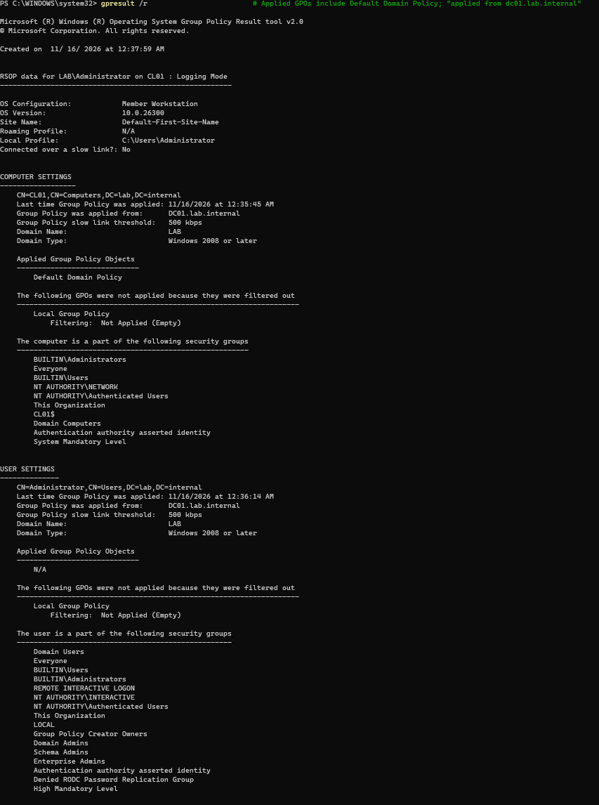
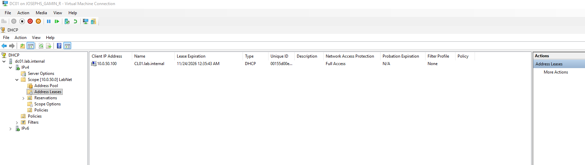
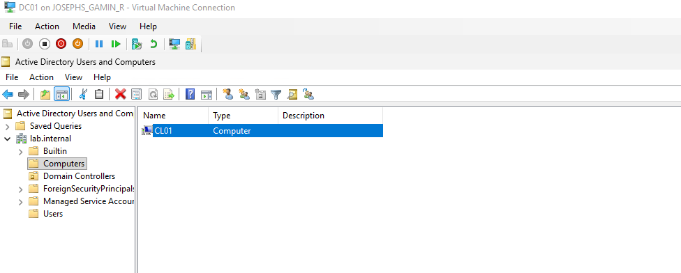

# Home IT Lab

A personal home lab for building hands-on systems administration experience: Windows Server, Active Directory, DNS, DHCP, Group Policy and PowerShell automation, with cloud identity and device management to follow.

This is a lab environment, not production. Everything here was built, broken and fixed by me on my own hardware.

## Lab topology

The lab runs on an isolated Hyper-V internal switch with NAT. VMs get internet access through the host, but the lab is walled off from my home network, so the lab DHCP server can't hand out addresses to household devices.

| Item | Value |
|---|---|
| Hypervisor | Hyper-V on Windows 10 Pro (Ryzen 9 5900X, 32 GB RAM) |
| Domain | `lab.internal` (NetBIOS `LAB`) |
| Domain controller | DC01: Windows Server 2025 Standard (Desktop Experience), 2 vCPU, 4 GB RAM |
| Client | CL01: Windows 11 Enterprise 26H2 (evaluation), 2 vCPU, 6 GB RAM, virtual TPM |
| Lab network | 10.0.50.0/24, gateway 10.0.50.1 (host NAT) |
| DHCP scope | 10.0.50.100-10.0.50.200, DNS 10.0.50.10, domain `lab.internal` |
| DNS forwarders | 1.1.1.1, 8.8.8.8 |

**Why `lab.internal`:** `.local` conflicts with multicast DNS (mDNS/Bonjour). `.internal` is reserved for private networks and never resolves publicly.

## Progress

### Phase 1: Windows Server domain
- [x] Enabled Hyper-V and built an isolated NAT lab network
- [x] Built DC01 and set its static IP, hostname and time zone
- [x] Installed AD DS and created the `lab.internal` forest
- [x] Configured AD-integrated DNS: self-referencing DNS client, forwarders, reverse lookup zone
- [x] Installed and authorized DHCP, with a scope and options for router, DNS and domain
- [x] Built a Windows 11 client (virtual TPM, Secure Boot) that gets its address and DNS from the DC's DHCP scope
- [x] Joined CL01 to the domain and verified it with `ipconfig /all`, `nslookup`, `nltest /sc_verify` and `gpresult /r`
- [ ] Create OUs, users and security groups; practice resets, unlocks and disabling accounts
- [ ] Build and troubleshoot GPOs (password/lockout, mapped drive, wallpaper, USB restriction)
- [ ] Automate onboarding and offboarding with PowerShell (CSV bulk-create, disable, move to a Departed OU)

### Later phases
- [ ] Phase 2: Microsoft 365, Entra ID and Intune, and/or JumpCloud plus Google Workspace
- [ ] Phase 3: pfSense/OPNsense firewall, VPN, Wireshark, Defender
- [ ] Phase 4: Ticketing (Jira Service Management / Freshservice) and asset tracking (Snipe-IT)
- [ ] Phase 5: Imaging with Sysprep or Windows Autopilot

## Build scripts

Run in order. Each script checks what already exists, so it's safe to rerun after a failure.

| Script | Runs on | What it does |
|---|---|---|
| [`00-host-setup.ps1`](scripts/00-host-setup.ps1) | Host | Enables Hyper-V; creates the LabNet switch and NAT; creates the DC01 VM |
| [`01-configure-server.ps1`](scripts/01-configure-server.ps1) | DC01 | Static IP, temporary DNS, time zone, rename to DC01 (reboots) |
| [`02-promote-dc.ps1`](scripts/02-promote-dc.ps1) | DC01 | Installs AD DS and creates the `lab.internal` forest (reboots) |
| [`03-configure-dns-dhcp.ps1`](scripts/03-configure-dns-dhcp.ps1) | DC01 | DNS client, forwarders and reverse zone; installs, authorizes and scopes DHCP |
| [`04-create-client-vm.ps1`](scripts/04-create-client-vm.ps1) | Host | Creates the CL01 Windows 11 VM with a virtual TPM on LabNet |
| [`05-join-domain.ps1`](scripts/05-join-domain.ps1) | CL01 | Checks the DHCP lease, DNS, SRV record and LDAP, then renames and joins the domain |
| [`verify-dc.ps1`](scripts/verify-dc.ps1) | DC01 | Pass/fail health check for services, DNS records, SYSVOL and DHCP |

No passwords are stored in any script. The DSRM password is prompted for at runtime.

## Screenshots

**DNS SRV record lookup.** The `_ldap._tcp.dc._msdcs` record resolves to DC01, so domain clients can find the domain controller.

**DHCP address pool.** The LabNet scope hands out 10.0.50.100-10.0.50.200. The green check on IPv4 shows the server is authorized in Active Directory.

**DHCP scope options.** Clients get router 10.0.50.1, DNS server 10.0.50.10 and domain `lab.internal`, so every domain machine uses the DC for DNS automatically.

**Active Directory Users and Computers.** The new `lab.internal` domain, with DC01 in the Domain Controllers OU.

**Client network configuration.** CL01 got its address from the DC's DHCP server, with DNS pointing at the DC and the `lab.internal` suffix.

**Group Policy result.** `gpresult /r` on CL01 shows the Default Domain Policy applied from DC01.

**DHCP leases.** CL01 holds a lease from the LabNet scope and registered its name, which shows the DHCP-to-DNS chain working end to end.

**Domain computers.** CL01's computer account in Active Directory after the join.

## Troubleshooting log

Problems I hit and how I solved them: [docs/troubleshooting.md](docs/troubleshooting.md)
